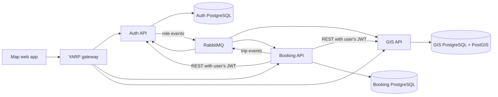

# Architecture

All three services validate Auth-issued JWT signatures, issuer, audience, and expiry. Service code enforces roles and resource ownership even when requests bypass the gateway. The gateway adds route policies. The frontend uses role guards for navigation; these are not the security boundary.

Shared.Contracts owns DTOs, geographic types, event envelopes, and role/claim constants. Shared.Infrastructure provides parameterized database access, JWT setup and broker transport. Domains hold pure rules. Each service owns its database and schema.

State and event outbox rows commit atomically. The broker worker marks rows published only after publisher confirmation. Delivery is at least once. Consumer processing and acknowledgement, retries, queue configuration and operational failure behavior must be considered when changing an event contract.

The diagram is an overview. For operational questions, inspect actual consumers, their handlers, deployment values and queue setup in code.
